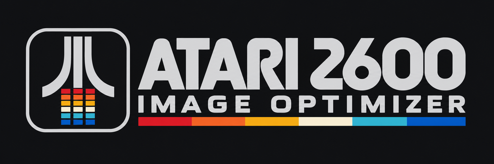

# Atari 2600 Image Optimizer



A Python desktop workbench for turning pictures into **NTSC Atari 2600 cartridge images**. This continues Chris Martin's 2011 Chrono2 converter, using Andrew Davie's original Interleaved Chronocolour display kernel and separate new scanline kernels.

Version **0.6.0** provides 22 NTSC display modes, including 128×200 BUS bitmaps,
48×192 options, and per-row foreground/background fitting. The flexible
three-frame modes are now **8 color mode** and **8 color per line mode**; the
original Chronocolor Classic remains available. Palette tables are prebuilt,
and the workbench separates Colors only, Image only, and Image + colors.
See [RELEASE-NOTES.md](RELEASE-NOTES.md) for the full changes and validation limits.
The [Demo Output](Demo%20Output/) folder contains the supplied example cartridge ZIP.

## Run

**Windows standalone:** download `Atari-2600-Image-Optimizer-v0.6.0-Windows-x64.zip`, extract the entire folder, and run `Atari-2600-Image-Optimizer.exe`. Keep `_internal` alongside the EXE. Python and the image libraries are included; no Python installation is required. This is an unsigned portable Windows x64 build.

BUS, DPC+ and CDFJ+ exports need their optional upstream cartridge support. Run the included **Setup cartridge support.cmd**, then click **Download cartridge support** once. The pinned files are checksum-verified and cached under `%LOCALAPPDATA%/RetroComputerist/Atari2600ImageOptimizer/drivers`. Other modes and previews work offline immediately. Stella is a separate installation.

**Python source package:**

On Windows, double-click **Run Atari 2600 Image Optimizer.cmd**. Python 3.12 or newer with Tkinter is required. The first run creates `.venv`, installs NumPy, Pillow and SciPy, and retrieves BUS, DPC+ and CDFJ+ cartridge support directly from the original upstream sources. These downloads require Internet access and are verified against pinned checksums. Later runs use the cached support files. No external assembler is required for export. The Source ZIP is for Python users; the separate Windows x64 ZIP includes the runtime.

Alternatively:

```text
python -m venv .venv
.venv\Scripts\python -m pip install -r requirements.txt
.venv\Scripts\python run.py
```

Pass an image path to `run.py` or drop it onto the launcher. The application starts with an original calibration image when no file is supplied.

## Image workflow

1. Open PNG, JPEG, BMP, GIF, TIFF or WebP. Animated inputs use their first frame; transparency is composited over black. EXIF orientation is honored.
2. Select an output mode. Its dimensions and Static/Flicker behavior appear directly below the selector.
3. Choose Fill / crop (default), Fit, or Stretch. Use **Crop zoom** above the input (1×–8×) to select a smaller source area, then drag the adjusted input to position it. Stretch fills the output and ignores aspect ratio, including when zoomed.
4. Adjust brightness, contrast and saturation. Advanced image adjustments contain gamma, sharpness, RGB gains, rotation, mirror and geometry. Resampling includes nearest, box, bilinear, Hamming, bicubic and Lanczos.
5. Choose colors and dithering. Ordinary image and dither edits refresh the preview with the existing palette. A new image or output mode initializes any required per-row palettes once.
6. Select **Image + colors**, **Image only**, or **Colors only**, then press **Optimize**. The explanatory line says exactly what may change.
7. Compare before/after and Undo optimization. Use ATARI Rendering Preview or Open in Stella, then Export. File contains settings, PNG preview, slowed frame GIF and Stella location commands.

### Crop zoom and view size

**Crop zoom** changes the source selection used by conversion, optimization and export. At 2×, each dimension of the selected source region is half its 1× size. Fill / crop also matches the target aspect; Fit letterboxes the selection; Stretch resizes it independently on both axes. Crop position is measured after rotation and mirror, clamped to the source edges, and saved with settings.

Drag **Adjusted input** to reposition the selection. **Center** centers the current selection; **Reset crop** returns to 1× and centers it. Opening another image resets the crop. **Reset image adjustments** resets tone/RGB/sharpness without losing the crop. **Original input** shows the full unadjusted source for reference; switch back to Adjusted input to drag the crop.

**View size → Pixel-perfect fit** uses whole screen-pixel blocks and nearest-neighbor display, so resizing cannot give neighboring image pixels different widths or heights. Smooth display is disabled in this view; its previous preference returns with other zoom choices. Atari 2:1 and raw-pixel geometry retain their exact pixel shape. Geometry requiring large fractional ratios, such as the 4:3 view of a 48×128 image, uses a nearby integer shape when necessary; the preview labels the approximation. Very small windows or large original images scroll instead of shrinking pixels. Windows starts with per-monitor DPI awareness to avoid a second bitmap-scaling step by the operating system. This affects preview display only.

**View size** magnifies the on-screen preview only; it does not change the exported image. Shift-drag pans the enlarged input view. Output dragging also pans. Original input, adjusted input and Atari output are separate views. Comparing before optimization is read-only: exports always use the current result unless Undo restores the earlier conversion.

### Optimization scope

| Scope | Changes | Preserves |
| --- | --- | --- |
| Image + colors | Tone/RGB controls and legal palette | Mode, crop, resampling, dither, sharpness |
| Image only | Brightness, contrast, gamma, saturation and RGB gains | Current palette and image geometry |
| Colors only | Legal palette for the selected mode | All image adjustments and geometry |

Picking a preset or applying manual colors selects **Image only**, so the next optimization respects that choice. Switching explicitly to a scope containing colors permits replacement. Classic RGB and BUS offer Image only because their available color sets are fixed. RGB colors stay fixed in Classic mode.

**Original Chronocolor / Classic RGB retains your image adjustments when selected.** Click Optimize to run its brightness-only search. Each candidate uses your selected dithering and the actual eight simulated temporal mixtures. Scoring compares relative perceptual lightness, local detail at several scales, and detail lost into black or the brightest mixture. Output light is normalized by the fixed palette ceiling, never by the candidate image's own brightness. The reference uses brightness 1.0 with your other adjustments retained. The search includes the current setting, 0.47 and 0.54, then refines the best regions; it is a bounded search, not a guarantee of a global perceptual optimum. Contrast, input gamma, saturation, RGB balance, sharpness, crop, and dithering are unchanged. Manual brightness edits remain available and do not trigger another search. Search effort is disabled for Classic, and the flicker switch does not add another adjustment. Other modes retain their existing optimizer. All modes still share linear-light rendering and CIEDE2000 color matching.

**Brightness trim (all modes)** is always visible above the image previews. It defaults to 1.00; lower it to darken the conversion target and reduce washout. The trim is applied after image adjustments and before palette mapping/dithering, so it changes real exported pixels, not the simulated monitor brightness. Colors only (the startup and reset default) and Image only preserve it. Image + colors is free to change the trim along with other input controls and the palette; the incoming trim does not constrain its reference target. The existing Brightness control remains available for automatic input fitting. Settings save the trim; older settings default to 1.00. Reset image adjustments and Reset all options restore 1.00.

The old Optimize input checkbox and Global optimize button are replaced by this scope selector and **Search effort: Standard / Thorough** under Advanced search. In 8 color mode, effort controls the ideal eight-color image refinement budget. Legal-palette matching uses the same exhaustive weighted comparison in both settings. Other modes retain their mode-specific effort settings.

Optimization keeps the previous result until completion. **Compare: before optimization** displays the starting conversion; **Undo optimization** restores it. The status line lists changed controls and whether colors changed. Editing during a search cancels it and refreshes using the current palette; it does not restart optimization. Press Optimize again when ready. Later image edits clear the one-step optimization comparison so it cannot be applied to a different image state.

### Flicker handling

Flicker modes default to **Automatic**: temporal brightness scoring and legal frame balancing. Expand Flicker handling to change either policy. Static modes hide this section; Classic and MovieCart disable the extra balancing control because their interleaving is fixed. These controls affect different things: scoring chooses candidates, while balancing rearranges equivalent phase assignments.

Every mode uses **linear-light blending and CIEDE2000 (Delta E 2000)**. Temporal scoring adds a separate cost for frame-to-frame light variation; turning it off retains the same color model. There is no automatic exposure gain, fixed 50%/75% reference budget, or forced darkening. Actual blank fields and backgrounds already determine the light emitted. Edges and lost detail are also scored to discourage collapsed images.

Frame balancing reduces whole-frame and local brightness imbalance where legal, preserving the exact emitted-light mixture. Row-based two-frame search prefers common backgrounds to permit phase swaps. Equal brightness and flicker-free temporal output are not guaranteed. MovieCart's alternating cells and Classic RGB's scanline rotation retain their fixed patterns. **Persistence** in ATARI Rendering Preview affects only that illustrative playback, not the optimizer or cartridge.

**Reset all options** restores conversion defaults and display options, cancels searches, closes the rendering preview and retains the loaded image and saved Stella location.

### Output modes

Select **Output mode** at the top of the controls. Cartridge modes export standalone ASM and headerless NTSC BIN files. MovieCart exports a real `.mvc` stream with settings and image data. Sizes and mapper types are shown in the program.

| Mode | Image | Colors and temporal behavior |
| --- | --- | --- |
| Chronocolor classic — Flicker | 48×128 | Locks original RGB components and black background; three-frame temporal mixture. |
| 8 color mode — Flicker | 48×128 | Custom components/background; weighted eight-color search with a dithered ideal image; three-frame mixture. |
| Two Color — Static | 48×128 | One solid foreground and background, identical on every frame; exhaustive legal color-pair search. |
| 8 color per line mode — Flicker | 48×128 / 48×192 | Three component colors per row; shared or independently fitted row backgrounds; three-frame temporal mixture. |
| Scanline color — Static | 48×128 | A foreground color per row and one shared background; identical frames. |
| No flicker — playfield — Static | 40×192 | A separately selected foreground/background pair per row, full playfield width, identical frames. |
| Playfield Plus — Static | 40×192 | Up to four solid colors per row: left/right score colors plus a timed background change. Static 16 KB F6 ROM. |
| Bus stuffing (experimental) — Static | 16×192 | Independent NTSC colors at coarse horizontal samples; 32 KB BUS2. |
| Multiplexed sprites — Static | 48×192 | Static six-strip sprite raster; one foreground per row, shared background; 4 KB. |
| DPC+ sprites — Static | 48×192 | Two foregrounds per row across alternating sprite strips; shared background; 32 KB DPC+. |
| CDFJ+ sprites — Static | 48×192 | Same static display, driven by CDFJ+ streams and an ARM initializer; 32 KB. |
| MovieCart frame — Flicker | 80×192 | 190 content rows, cell colors and row backgrounds, two alternating fields; 30-second silent MVC stream. |
| Two Color (2 frames) — Flicker | 48×128 | Two global foreground colors with a shared background and alternating A/B scanlines by default; four temporal mixtures; 8 KB F8. Disable frame balancing to search independent backgrounds. |
| Scanline color (2 frames) — Flicker | 48×128 | Foreground per row in each frame; a background per frame; 8 KB F8. |
| Multiplexed sprites (2 frames) — Flicker | 48×192 | Foreground per row in each frame; a background per frame; 8 KB F8. |
| DPC+ sprites (2 frames) — Flicker | 48×192 | Separate P0/P1 colors per row in each frame; background per frame; 32 KB DPC+. |
| CDFJ+ sprites (2 frames) — Flicker | 48×192 | Same two-frame constraints, with CDFJ+ streams; 32 KB CDFJ+. |

Scanline modes fit their row palettes automatically on initial conversion. Choose Colors only or Image + colors to refit them explicitly after edits. Per-line temporal search uses a bounded coordinate search; static row/pair fitting evaluates all allowed hardware colors. Those mode-specific searches remain separate from the Custom weighted eight-color search. The playfield mode initially selects Any Atari color for its background search, allowing both colors to change per row; Black and Black or white constraints remain available. Sprite modes select a shared background before fitting individual rows.

Scanline palettes are saved with settings. Swatches display the selected row; they are not a claim that the entire raster has one palette. Flicker-free means the image data and colors repeat each television frame: normal CRT refresh and display characteristics still apply. The finer-resolution modes constrain colors by row or region; the experimental BUS raster instead allows arbitrary NTSC colors at just 16 samples across. See [RESEARCH.md](RESEARCH.md) for source material, cycle budgets, trade-offs and verification.

### Playfield Plus

This mode fits separate left and right color pairs on every row. **Score mode** routes the left foreground through COLUP0 and the right through COLUP1. A timed COLUBK write changes the background during the line. The result repeats every frame, with no temporal color cycling.

The background changes at television x=76 and the score foreground changes at x=80. That one-playfield-pixel offset is intentional: exact CPU timing cannot put this COLUBK write at x=80. Logical pixel 19 therefore chooses between the left foreground and right background. Preview, dithering and exports use that same constraint, avoiding a partial-pixel seam. Other pixels choose from their side's pair; this is not unrestricted four-color selection at every pixel.

Entering the mode selects **Any Atari color** for background search. Black or Black/white restrictions remain available. Input-only fitting, joint optimization, crop, resampling and all dithers work with the spatial palette. Color swatches are read-only samples of the selected row, labeled L FG, L BG, R FG and R BG.

Exports are standard **16,384-byte F6** cartridges. Open in Stella automatically selects F6. Other emulators or cartridges must support F6; do not force the older 4K format. Hardware/Harmony validation remains outstanding.

### Editing palette colors

Manual component editing applies to 8 color mode and Two Color. Classic locks RGB; scanline-mode swatches are read-only selected-row samples, with colors fitted independently by the optimizer.

The eight output swatches **0–7** are followed by **Component 1, 2, 3 and Background** previews. Click a component to choose from the 128 valid NTSC colors. The eight blended output swatches are read-only; edit their components instead. The dialog previews all eight resulting mixtures; **Apply colors** commits the changes, while Cancel leaves the current palette untouched. Output colors cannot be edited independently because the cartridge derives them from the same four hardware colors.

### Animated cartridge preview

**Export animated preview…** is above the Atari output image, in the File menu, and inside ATARI Rendering Preview. It opens a website export dialog and saves a looping **lossless animated WebP** without application controls. The main-window button defaults to nominal 60 fps, 60% persistence and a 640-pixel longest side. Exporting from the rendering window starts with that window's current speed and persistence.

Choose 60, 30, 10 or 3 fps; 0–80% persistence; and a 320, 640 or 960-pixel longest side. Display proportions and crisp nearest-neighbor pixels are preserved. Zero persistence exports the raw fields. Static modes save a still WebP. The dialog captures the completed conversion when opened, so later edits cannot mix different results into one export. It always exports that conversion, not the before-optimization comparison.

Click **Save WebP…** and choose the destination. The resulting `.webp` can be used as a website gallery image. Actual browser playback is not synchronized to the Atari or to a particular CRT. File → Save frame GIF remains available as the older, slowed 100 ms/frame illustration.

**ATARI Rendering Preview** opens a separate window using the completed conversion’s actual stored frames in cartridge order. Nominal NTSC pace is approximately 60 frames per second: a three-frame cycle is about 20 Hz, a two-frame cycle about 30 Hz. It displays the frames themselves, with optional persistence, rather than only their static average.

Static modes show one image and identify themselves as static. Two-frame modes show two frames; Classic and the 8 color modes show three. The main output selector follows the same frame count.

Use Pause/Play, Next frame, or slower 30/10/3 fps playback. Space toggles playback, Right Arrow steps one frame, and Escape closes this preview window. Phosphor persistence starts at **60%** and adds an illustrative trail from preceding frames; set it to zero for raw frame cycling. Resizing preserves the chosen image geometry and crisp pixels. Reopening the preview loads the latest completed conversion into the same window.

This remains a desktop simulation, not an emulator or a prediction of an exact CRT. Timing is not synchronized to monitor refresh. The window reports software frame updates and skipped phases; it cannot measure which frames your display actually presents. Slow motion deliberately changes the timing. Use the existing Stella action or hardware to validate the cartridge's real execution.

### Geometry and preview meaning

The default **Atari pixels 2:1** follows the historical instructions: 48×128 logical pixels occupy roughly a 96×128 image area. The entire television screen is not filled by that image. Existing 48×128 inputs are treated as already prepared logical pixels. Raw-pixel view and a 4:3 stretched image view are also available; they do not change the cartridge dimensions.

The bundled NTSC RGB palette is treated as **display-referred sRGB**, with D65 as the shared reference white. Decode to linear light, average actual frames, then encode once for display. An ideal full red/green/blue cycle therefore previews around sRGB 156 gray, not 85. Real Atari palette primaries are less bright and saturated than those ideal values.

This is a consistent reference model, not a measured CRT calibration. No second CRT gamma is applied to already encoded colors. The Input gamma slider remains a creative image adjustment. Palette fitting, all dithers, input fitting, static previews and persistence playback share this model. Diffusion carries residual light in linear RGB; nearest-color choices use CIEDE2000 in D65 Lab. The obsolete ideal-RGB quantization bypass has been removed; old settings load using the shared model. Saved settings identify the color-model version, so re-converting old settings can produce different pixels. Existing ROM files are not modified.

### Error diffusion

Diffusion first bounds the source to mixtures the local palette can reproduce, preventing impossible highlight/color energy from accumulating and spilling into adjacent shadows. Signed residuals are retained instead of clipping away negative error. Exact black input pixels remain black when the local palette contains black; this does not invent black for palettes that lack it. These rules apply to all six diffusion methods, including row and spatial palettes. Ordered dithering and no-dither conversion retain their existing behavior.

### Palette search

**Weighted eight-color** is the only 8 color mode palette search. Startup and Reset all options select **Colors only**, **Thorough**, and **Black**. Black or white and Any Atari color remain available. Old search names in saved settings migrate automatically.

The first stage builds an ideal eight-color image using colors from the simulated mixed-color pool, independently of whether those colors coexist in one legal palette. Black is reserved for Black searches. Deterministic starting palettes and bounded spatial least-squares refinements are evaluated with the selected dither, strength and serpentine setting. A multiscale DE00/detail score selects the best rendered ideal image. Standard permits up to 8 trials; Thorough up to 16. This is a constrained heuristic, not a guarantee of globally optimal eight-color quantization.

The second stage uses the actual dithered pixel counts as palette weights. Colors only compares all 357,760 foreground triples for each allowed background (45,793,280 combinations with any background). Distances to mixed colors are precomputed; candidate comparisons perform only table lookups and weighted arithmetic. The optional temporal-brightness score uses weighted three-frame luminance variance. This is exhaustive for the weighted palette proxy, not the entire original-image dither objective. No repeated full-image renders are performed during matching.

Image + colors first builds the ideal palette from neutral input. Every legal candidate is screened using a direct, per-channel affine range fit and weighted normalized RGB error. The best 128 screening candidates are ranked with weighted CIEDE2000 on the toned ideal colors, range normalization and a penalty for collapsed channels. This final DE00 ranking is a shortlist refinement, not exhaustive DE00 over all arbitrary-background palettes. Only the winner is applied to the original image. The old alternating input/palette loops are bypassed for Custom.

Joint scoring also penalizes RGB casts and lifted black levels after removing a common brightness gain; uniform dimming remains free. This prevents a narrow red or blue palette from winning simply by recoloring the entire ideal image.

Image only directly fits source 1st/99th-percentile channel ranges to the current palette. Colors and crop stay fixed. Nearly flat channels use the full 0–255 reference range to avoid extreme gains. Brightness, RGB gains and fitted RGB offsets persist in settings and exports. Offsets are displayed with the output preview. Reset image adjustments clears them. Joint fitting replaces the prior input adjustments and resets manual trim to neutral; Colors only preserves every input adjustment; Image only retains manual trim. Classic keeps its dedicated brightness-only algorithm. Other display modes retain their specialized searches.

The mixed-color catalog is cached in memory. Windows x64 uses the bundled, dependency-free `chrono/native/palette_match.dll`; its C source and reproducible build script (`scripts/build_palette_matcher.py`) are included. The NumPy fallback produces equivalent matching scores but is slower, especially for joint arbitrary-background searches. Rebuilding the helper requires Visual Studio C++ build tools. Standalone packaging rebuilds and includes it.

## Cartridge output

The BIN is a headerless **NTSC ROM: 4096 bytes / 4K**, **8192 bytes / F8 for ordinary two-frame sprites**, **16384 bytes / F6 for Playfield Plus**, or **32768 bytes / BUS for the experimental color raster**. No assembler installation is needed to export it: the program inserts image data and colors into the selected, integrity-checked kernel template. The accompanying ASM is self-contained and can be rebuilt with DASM:

```text
dasm image.asm -f3 -oimage.bin
```

Automated tests independently assemble exports with DASM and compare every byte of each cartridge format. Classic/custom/two-color output retains the original kernel. Separate raster templates have also been exercised in Stella with exact pixel-plane and 262-line timing checks. PAL/SECAM output is not offered. Physical Atari/Harmony testing remains outstanding.

## Development and checks

```text
python -m unittest discover -s tests -v
python tests/gui_smoke.py
python tests/gui_optimization_regression.py
python tests/gui_modes_smoke.py
python tests/gui_flicker_smoke.py
python tests/gui_workflow_smoke.py
```

Set `DASM_PATH` to a DASM executable to enable the independent assembler parity test. `scripts/rebuild_kernel.py` rebuilds the bundled template and discovers the color operand offsets using DASM. Do this only when intentionally changing the kernel, then rerun parity tests.

`scripts/rebuild_raster.py` rebuilds all three new raster templates. `scripts/verify_stella_raster.py path/to/Stella.exe` uses isolated debugger scripts to capture three frames, check image masks, per-row colors and NTSC timing. Test output and emulator preferences stay under ignored `test-output/`.

Historical originals and ZIP releases are preserved outside this source checkout. Private research, old image collections, virtual environments, outputs and assembler binaries are not part of this public repository.

## Credits and history

- Chris Martin: original Chrono2 image converter and project direction.
- **Andrew Davie:** 2003 Interleaved Chronocolour sprite technology and cartridge kernel. His full notice remains in `chrono/resources/kernel.asm` and classic/custom/two-color exported ASM. New raster ASM acknowledges the sprite technique separately.
- **Eckhard Stohlberg and Thomas Jentzsch:** foundational sprite work and contributions acknowledged by Andrew's original source.
- Python GUI and conversion implementation developed with Codex in 2026, following the recovered FreeBASIC source and the owner's requirements.

Original discussion: [Chronocolour Enhancement](https://forums.atariage.com/topic/174658-chronocolour-enhancement/) and [New Graphics for 2600](https://forums.atariage.com/topic/175649-new-graphics-for-2600/).

No new license is asserted over third-party historical code. Retain the original notices and credit Andrew's contribution in documentation accompanying ROMs made with this kernel. See [CREDITS.md](CREDITS.md).


## Bus Stuffing - 128x200 Single Color

Choose **Bus Stuffing - 128x200 Single Color — Flicker** to reproduce the 128-pixel bitmap technique derived from cd-w / SpiceWare's 128bus_20170120 demo. There is one foreground and one shared background. Each pixel is drawn in one of two complementary fields; the preview, palette search and input optimization account for the 50% foreground duty using the shared linear-light model.

ATARI Rendering Preview and animated WebP export show the actual fixed field pattern. Crop/zoom, scaling and all dithers remain available. Export produces a 32 KiB BUS2 BIN and self-contained DASM ASM. Optional BUS support must be installed. Physical Harmony/console testing remains outstanding. See BUS-RESEARCH.md for the kernel provenance and verification.

## Bus Stuffing - 16x192 Color Raster

Choose **Bus Stuffing - 16x192 Color Raster — Static** under Output mode. It exports a genuine BUS2 cartridge and displays **16 × 192 independent color samples**, each free to select any of the 128 NTSC colors. Samples are nine color clocks wide; this is deliberately coarse horizontally but has no temporal flicker. All scaling, cropping, input controls and dithering remain available. The full NTSC color chart replaces component swatches. There is no restricted palette to search; Image only optimization adjusts the image.

Open in Stella selects BUS. The 32 KiB BIN includes its cartridge driver, ARM initializer, image and timed kernel. Generated ASM rebuilds the same BIN with DASM. **Stella rendering and timing are verified; physical console/Harmony compatibility is not.** The mode is experimental and should not be treated as a portable ordinary 4K cartridge.

See [BUS-RESEARCH.md](BUS-RESEARCH.md) for exact geometry, verification, reference-driver provenance and a comparison with playfields, sprite bitmaps, Chronocolour, DPC+/CDF and MovieCart. The historical BUS driver's redistribution terms still need to be established before public release; this is currently a local experimental build.


## Cartridge support and public packaging

Third-party BUS, DPC+ and CDFJ+ driver bytes are **not included** in this repository or the release ZIP, including inside generated templates. The public templates contain zero-filled driver slots. Setup downloads the tested drivers from pinned upstream sources and validates SHA-256; BIN export inserts the locally fetched support bytes. Normal first launch handles setup; `Setup cartridge support.cmd` retries it. Other modes remain usable if that optional download fails.

The original authors retain their rights. CREDITS.md and ADVANCED-MODES.md link the sources. The fetch mechanism does not grant a new license to redistribute those drivers or ROMs containing them. Their redistribution terms remain an upstream matter.

The historical `Run Chrono2.cmd` remains a compatibility launcher. Existing settings, repository URLs and machine-local Stella preferences continue to work. Historical Chrono2 files are not renamed.


## BUS 128x200 Color per Line

Choose **Bus Stuffing - 128x200 Color per Line — Flicker** beside the Single Color mode. Each of the 200 rows has one independently fitted foreground color, with one shared background for the entire picture. This keeps the same 128-pixel detail and two alternating spatial fields as the original single-color mode; it does not provide arbitrary full color at each pixel.

The first conversion fits row colors automatically. Choose **Colors only → Optimize** to refit them, or **Image + colors** to search image adjustments too. The background selector permits black, black/white, or any Atari color. The row inspector shows the foreground and shared background; Image only and crop/dither changes retain those colors. ATARI Rendering Preview and animated WebP export show the actual field layout. Matching uses the linear-light 50% foreground/background mixture.

ASM and 32 KiB BUS BIN exports use a new timed kernel that updates both sprite colors in horizontal blanking. DASM parity and Stella pixel/timing checks pass; physical Harmony/console validation is still outstanding. Cartridge support uses the same optional BUS2 driver setup as Single Color. Restart the source application to load the new selection.

### Optional paired-row color variety

In **Bus Stuffing - 128x200 Color per Line**, enable **Colors → Paired rows — force color variety** to fit rows 0–1, 2–3, and so on together. Every pair receives two different foreground colors, one per row, plus the existing global background. All three are different physical palette RGB colors; synonymous color codes do not count as variety. This is strict even in flat areas, so visible alternating-row texture is expected. Black pixels can remain background even though the pair's foreground colors differ.

The search evaluates the actual two-row output averaged in linear light, with additional weight on the original row detail. It checks both upper/lower assignments. Input optimization uses the same paired view of the image; ATARI Rendering Preview still shows the real individual rows and temporal fields. Dithering remains the selected method, with no new downward error transfer. Toggling the option refits the row colors; ordinary image adjustments and Image only retain them. The option is saved in settings, defaults off for existing projects, and Reset all options turns it off.

Paired fitting is a bounded search: all allowed shared backgrounds are screened, the best four are evaluated jointly, and candidate foregrounds include leading row/average fits and representatives of every TIA hue family. It does not claim an exhaustive optimum. The cartridge format and kernel are unchanged.


### Random row colors and dithering during palette selection

The **Random** button under Colors is available in **Bus Stuffing - 128x200 Color per Line**. It assigns a random foreground to every row, keeps the current shared background, and never repeats a visible foreground color on adjacent rows. Foregrounds also differ from the background. Palette aliases that have identical RGB values do not count as different colors. Random works with the paired-row checkbox on or off.

Random is a one-shot action: adjustments, dithering changes, previews and exports keep the resulting row table. Settings save the actual colors, so reopening does not roll them again. Press Random again for another table. Random selects Image only optimization; explicitly choose Colors only or Image + colors to replace the random table with fitted colors.

BUS row-color fitting now evaluates shortlisted complete palettes through the **selected final dithering path**, including strength, serpentine order, gamut projection, black protection and diffusion across rows. This applies to independent and paired-row searches. A residual-feedback proposal is generated from the rendered result and tested again on the unchanged source. A worse-scoring trial cannot replace the current best. This is a bounded refinement, not an exhaustive search over every possible row palette; Standard tests fewer candidates than Thorough. Searches with None or zero strength retain the existing undithered fitting behavior.

Choose the dithering method before running Colors only or Image + colors. Changing the dither alone keeps existing colors; the next explicit color search evaluates that method. Full-image candidate renders take additional time and support cancellation. Kernel timing and cartridge packing are unchanged.

### Selectable 48×192 raster

Two Color (Static), 8 color mode and 8 color per line mode have a Resolution
selector beneath Output mode: **48×128** (default) or **48×192**. Settings files
retain the choice. Changing resolution refits any per-line palettes for the new
row count; global colors and image controls remain available as before.

At 192 rows, Two Color uses the existing 4 KB sprite kernel. The 8 color modes use a standard 16 KB F6 cartridge with three interleaved frames and a
shared background. Per-line backgrounds use the 64 KB EF extension described below.
No bus stuffing or ARM driver is needed. Shared-background 128-row exports and
Classic mode are unchanged. Atari pixels 2:1 keeps the pixel shape at
either height; Display 4:3 fills a 4:3 picture. Emulator validation does not replace
physical Harmony/TV testing.

### Fast Two Color Static optimization

Two Color Static uses a small population-weighted two-color match instead of
repeated palette/input searches. It groups the image into at most 512 color bins,
fits two Lab color centers, and snaps them to actual Atari colors. Black,
Black or white, and Any Atari color background choices remain available.

Colors only preserves all input adjustments. Image only makes one direct RGB
range fit to the existing palette, comparing it with the current input using the
selected dithering and retaining the better result. Image + colors matches the
palette once, then performs that same input fit; it can reset exposure trim.
Standard/Thorough is disabled for this mode because there is one bounded method.
This is a speed-oriented approximation, not an exhaustive optimum. Final pixel
matching and dithering are unchanged. It works at both 48×128 and 48×192.

### Prebuilt mixed Atari palettes

The application bundles the eight-color temporal-mixture catalog and lookup tables in
`chrono/resources/mixed-palettes`. First use opens read-only memory-mapped arrays;
subsequent modes and searches reuse the same catalog. It does not regenerate the
357,760 foreground triples, 320,818 unique mixed RGB colors, Lab coordinates or
128×128×128 component lookup cube during normal use. Shared-background palettes
are assembled by indexing this cube, including arbitrary Atari backgrounds.
The small nearest-color search index is created once in memory.

Developers: run `python scripts/build_mixed_palettes.py` to generate/update the
resources, or add `--check` to validate without writing. The Windows packaging
script runs this build step automatically and includes the data folder. Files
use NumPy's non-pickle format with explicit types, shapes, SHA-256 checksums and
a color-model/palette signature. Increment the store format when changing the
blend-generation algorithm; update the shared color-model version when changing
color science. Missing, damaged or stale resources produce a repair message,
rather than silently rebuilding during an interaction. Image-dependent palette
selection and dithering still run for each image.

### Selecting 8 color per line mode

Selecting 8 color per line mode, opening a new image in it, or changing its raster
height starts a preview with the current palette copied to each row. These actions
no longer launch the expensive row-by-row color search. Click Optimize with
**Colors only** or **Image + colors** to fit a different palette to each row;
progress reports the row count. **Image only** keeps the current row palettes.
Previously saved row palettes still load and render directly.

**Background for color search → Any color by line** lets each row choose its own
background from all 128 Atari NTSC color codes, alongside its three component
colors. **Any Atari color** still chooses one shared background; **Black** and
**Black or white** keep their shared-background restrictions. Click Optimize to
apply a new search choice. Image only retains the existing row colors.

The row search uses the existing perceptual coordinate-descent fit, now varying
all four color slots when requested. It tries every Atari code for each slot,
with both the preceding row and an image-derived palette as starting points.
This is not an exhaustive four-color search or the static Scanline Color
mode's dither-aware pair search. Final conversion uses the selected dithering.

Changing-background exports use a driver-free **64 KB EF cartridge** at either
height. All three temporal phases share each row's selected background. The
kernel reuses the unrolled 48-pixel raster, and advances phase after a complete
frame. A uniform background retains the smaller 4 KB / 16 KB export. ASM and BIN
are byte-for-byte checked with DASM; Stella checks all pixels in the three phases
and 262-line NTSC timing. An EF identification tag supports automatic detection;
Open Stella explicitly selects the correct format. A black priority-playfield
mask covers both side margins, and the background clears after the final row,
so changing row colors remain inside the active picture. Stella verification
checks all outside pixels as well as the picture and timing. Existing exported
ROMs must be exported again to receive this fix. Physical cartridge testing
remains outstanding.


### Scanline Color: dither-aware foreground and background

Scanline Color is a static, two-color-per-row mode at 48×128 or 48×192.
The background search choices are Black, White, Any Atari color (one shared
background), and Per line (independent foreground/background for each row).
Choose the dithering method, strength and serpentine setting before clicking
Optimize with Colors only or Image + colors. Changing those settings alone
re-renders the existing palette; click Optimize to refit its colors.

The search tests actual dithered rows with error carried from preceding rows.
Fixed backgrounds test all 128 foreground codes. Per line tests all 8,256
unordered pairs (including single-color pairs), with no shortlist or effort
reduction. Every candidate receives the same incoming error; horizontal
diffusion runs during its trial, and only the winning row commits error to
subsequent rows. Four independent batches accelerate this exact evaluation.
Arbitrary shared backgrounds still use a mixture-range shortlist. Per-line
search is exhaustive for each row given incoming error, not over every possible
combination of palettes across the entire image. A full-raster nearest-color baseline and valid current
palette are retained if the proposed rows score worse. The viewing score
combines individual pixel error, horizontally averaged linear-light color,
and brightness edges; it does not invent additional cartridge colors.

Cartridges use a driver-free 16 KiB F6 kernel with unrolled immediate data.
Both foreground and background are written for every line. ASM and BIN match
byte-for-byte under DASM. Stella checks cover independently changing colors,
all 48 pixels, bank transitions, both heights and 262-scanline NTSC frames.
This is emulator verification, not physical Harmony cartridge validation.

### BUS 128×200 Color per Line: shared scanline search

BUS Color per Line uses the same row-by-row candidate renderer as static
Scanline Color. Each tested shared background evaluates all 128 foreground
codes on every row with the selected dithering, strength and serpentine
setting. Each candidate inherits the same error, diffuses horizontally during
its trial, and only the winning row passes error to later rows. The final
preview uses that same renderer. BUS pixels are scored as their actual
50%-duty foreground/background blend, not as full-brightness static pixels.

The cartridge still has one shared background. Black and Black-or-white
constraints are retained. Any Atari color screens all shared backgrounds,
then renders the leading whole-image candidates, as in static Scanline Color;
it does not test all possible whole-image background/row combinations.
Paired rows exclude the background and the other row's foreground, and score
the second row with its companion's linear-light average. Random row colors
remain fixed until explicit color optimization. The existing legal palette
and a baseline are retained when a new pass scores worse. Cartridge timing,
stream layout, driver requirements and export format are unchanged.
